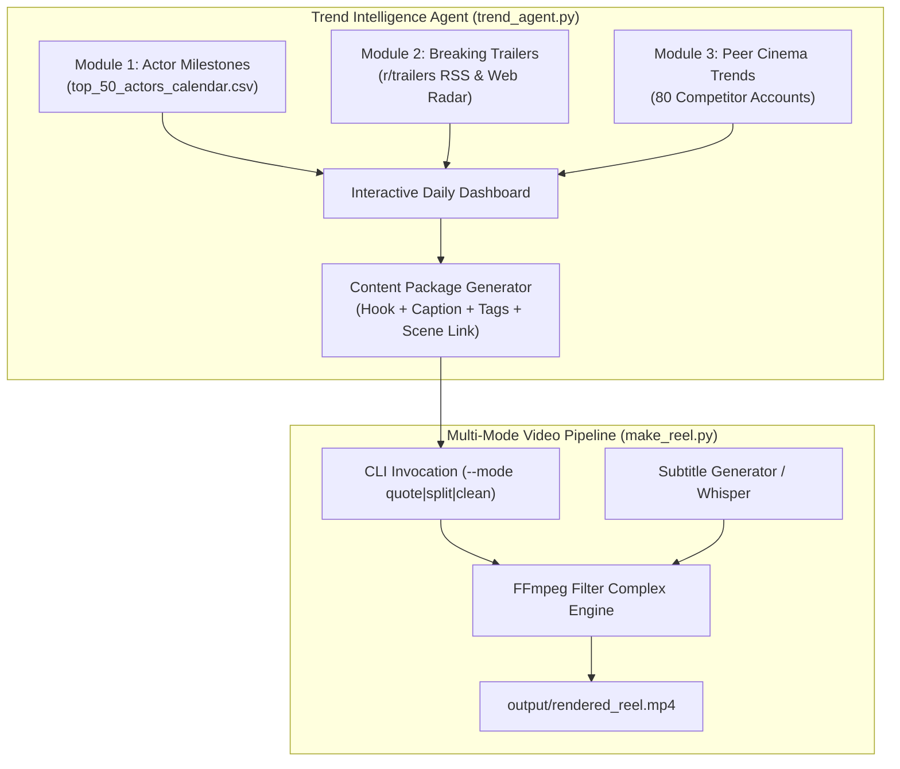

# Framefluence Trend Agent & Multi-Mode Video Pipeline Implementation Plan

> **For agentic workers:** REQUIRED SUB-SKILL: Use superpowers:subagent-driven-development to implement this plan task-by-task. Steps use checkbox (`- [ ]`) syntax for tracking.

**Goal:** Build an automated trend research agent and multi-mode 9:16 video generation engine to research, script, format, and render Instagram Reels for `@framefluence`.

**Architecture:** A Python-based automation suite consisting of two integrated subsystems: `make_reel.py` (multi-mode FFmpeg video engine supporting quote, split-screen, and clean reels) and `trend_agent.py` (a 3-module intelligence agent tracking upcoming actor milestones, breaking trailers, and live peer page trends across 80 cinema accounts). An interactive terminal interface allows selecting a daily trend and automatically triggering video rendering.

**Architecture Diagram:**

**Tech Stack:** Python 3.10+, FFmpeg 7.1, `requests`, `unittest`, Python standard library (`csv`, `urllib.request`, `xml.etree.ElementTree`).

**Spec:** [`docs/superpowers/specs/2026-09-18-trend-agent-and-video-pipeline-design.md`](file:///C:/Users/Paarth/OneDrive/Desktop/Framefluence/docs/superpowers/specs/2026-09-18-trend-agent-and-video-pipeline-design.md)

---

## Global Constraints

- **FFmpeg Path:** Must use system `ffmpeg` (pre-installed at `C:\Users\Paarth\AppData\Local\Microsoft\WinGet\Packages\Gyan.FFmpeg_Microsoft.Winget.Source_8wekyb3d8bbwe\ffmpeg-7.1.1-full_build\bin\ffmpeg.EXE` or available in PATH).
- **Target Video Format:** 9:16 vertical canvas (`1080x1920`), H.264 video (`libx264`), AAC audio (`aac`), 30/60 fps.
- **Cost & Dependencies:** 100% free, local-first execution without mandatory paid API keys.
- **Testing:** Strict TDD (Test-Driven Development) for all components before implementation code is finalized.

---

## Task 1: Multi-Mode Video Engine Core (`make_reel.py`)

**Files to touch:**
- `make_reel.py` (Upgrade existing file)
- `tests/test_make_reel.py` (New test file)

- [ ] **Step 1: Write failing test for multi-mode argument parsing and filter generation**
  - Create `tests/test_make_reel.py` testing CLI flags (`--mode quote`, `--mode split`, `--mode clean`) and verifying that valid FFmpeg filter strings are constructed for each mode.
- [ ] **Step 2: Run test to confirm failure**
  - Run `python -m unittest tests/test_make_reel.py` and verify test fails.
- [ ] **Step 3: Implement multi-mode rendering in `make_reel.py`**
  - Support `quote` mode: scales 1080x1920 blurred background, centers crisp 1080px video, applies contrast boost, adds `@framefluence` watermark.
  - Support `split` mode: stacks top video/content and bottom video into 1080x1920 canvas.
  - Support `clean` mode: 9:16 blur canvas without burned text.
- [ ] **Step 4: Run test to confirm pass**
  - Run `python -m unittest tests/test_make_reel.py` and confirm all tests pass.
- [ ] **Step 5: Commit changes**
  - Commit Task 1 changes to git repository.

---

## Task 2: Subtitle Engine & Styling (`subtitle_engine.py`)

**Files to touch:**
- `subtitle_engine.py` (New module)
- `tests/test_subtitle_engine.py` (New test file)
- `make_reel.py` (Integrate subtitle module)

- [ ] **Step 1: Write failing test for subtitle generation and styling**
  - Create `tests/test_subtitle_engine.py` testing creation of formatted `.srt` / `.ass` files with centered lower-third positioning, yellow/white color scheme, and black border.
- [ ] **Step 2: Run test to confirm failure**
  - Run `python -m unittest tests/test_subtitle_engine.py` to confirm failure.
- [ ] **Step 3: Implement `subtitle_engine.py`**
  - Write functions to format text/dialogue into timed SRT/ASS subtitles with cinema typography settings.
  - Connect `--subtitles` and `--hook-text` options in `make_reel.py` to burn styled text into output videos.
- [ ] **Step 4: Run tests to confirm pass**
  - Run `python -m unittest tests/test_subtitle_engine.py` and verify all tests pass.
- [ ] **Step 5: Commit changes**
  - Commit Task 2 changes.

---

## Task 3: Trend & Suggestion Agent Intelligence Modules (`trend_agent.py`)

**Files to touch:**
- `trend_agent.py` (New module)
- `tests/test_trend_agent.py` (New test file)

- [ ] **Step 1: Write failing tests for the 3 intelligence modules**
  - Test Module 1: Reads `top_50_actors_calendar.csv` and returns actors within a 14-day threshold.
  - Test Module 2: Parses RSS feeds (e.g. `r/trailers` RSS) and returns recent movie trailer titles.
  - Test Module 3: Scans `cinema_competitors_and_benchmarks.csv` and queries recent trending peer titles/quotes.
- [ ] **Step 2: Run test to confirm failure**
  - Run `python -m unittest tests/test_trend_agent.py` and confirm failure.
- [ ] **Step 3: Implement the 3 modules in `trend_agent.py`**
  - Write `get_upcoming_milestones(calendar_path, days=14)`.
  - Write `get_breaking_trailers()`.
  - Write `get_peer_trends(benchmarks_path)`.
- [ ] **Step 4: Run tests to confirm pass**
  - Run `python -m unittest tests/test_trend_agent.py` and verify all 3 modules return structured data correctly.
- [ ] **Step 5: Commit changes**
  - Commit Task 3 changes.

---

## Task 4: Interactive CLI Dashboard & Pipeline Bridge

**Files to touch:**
- `trend_agent.py` (Add CLI dashboard and launcher)
- `tests/test_cli_integration.py` (New test file)

- [ ] **Step 1: Write failing test for content package formatting and command generation**
  - Test that picking Option 1, 2, or 3 produces:
    - Text hook
    - Instagram caption with engagement question
    - Hashtag list
    - Recommended `make_reel.py` command line arguments.
- [ ] **Step 2: Run test to confirm failure**
  - Run `python -m unittest tests/test_cli_integration.py`.
- [ ] **Step 3: Implement interactive CLI interface in `trend_agent.py`**
  - Add colorful terminal output with options `[1]`, `[2]`, `[3]`.
  - Add interactive selection prompt and command executor calling `make_reel.py`.
- [ ] **Step 4: Run tests to confirm pass**
  - Run `python -m unittest tests/test_cli_integration.py`.
- [ ] **Step 5: Commit changes**
  - Commit Task 4 changes.

---

## Task 5: End-to-End Verification with Sample Generation

**Files to touch:**
- `tests/test_end_to_end.py` (New test file)
- `output/` (Directory for rendered sample videos)

- [ ] **Step 1: Write end-to-end integration test**
  - Generate a 5-second synthetic test video using FFmpeg.
  - Run `make_reel.py` in `quote` mode on the sample video with hook text.
  - Verify that the resulting video in `output/` exists, has 9:16 resolution (`1080x1920`), valid audio/video streams, and non-zero filesize.
- [ ] **Step 2: Execute end-to-end test and inspect output**
  - Run `python -m unittest tests/test_end_to_end.py`.
- [ ] **Step 3: Run full live briefing of `trend_agent.py`**
  - Execute `python trend_agent.py --briefing-only` to verify live terminal output of all 3 modules.
- [ ] **Step 4: Final commit & documentation update**
  - Update README and commit all verified changes.
