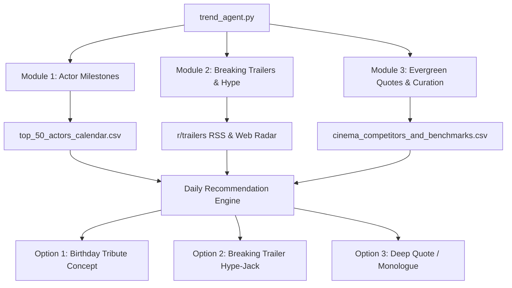

# System Design: Framefluence Trend Research Agent & Multi-Mode Video Pipeline

- **Date:** 2026-09-18
- **Project:** Framefluence Instagram Growth & Automation Engine
- **Status:** Proposed (Under Review)

---

## 1. Executive Summary

This specification defines the architecture for two interconnected subsystems designed to scale the `@framefluence` Instagram page:
1. **The Multi-Mode Video Engine (`make_reel.py`)**: An automated rendering pipeline built on FFmpeg and Whisper AI that transforms raw footage into high-retention 9:16 Instagram Reels across 3 distinct aesthetic modes.
2. **The Trend Research & Suggestion Agent (`trend_agent.py`)**: A 3-module intelligence agent that continuously tracks upcoming actor milestones, breaking movie trailer releases, and peer-validated evergreen quotes, presenting daily actionable Reel recommendations in an interactive terminal interface.

---

## 2. External Tools & Free Integrations Identified

To achieve maximum reliability without ongoing costs or fragile dependencies, the system integrates:

| Layer | Tool / Source | Purpose | Cost |
| :--- | :--- | :--- | :--- |
| **Video Processing** | **FFmpeg 7.1** *(Pre-installed)* | High-speed multi-pass scaling, boxblur filters, split-screen overlays, subtitle burning. | Free / Open Source |
| **Speech-to-Text** | **faster-whisper / Whisper** | Word-level timestamp generation and animated kinetic subtitles (`.ass` styling). | Free / Local |
| **Video Ingestion** | **yt-dlp** | 1080p clip downloader from YouTube/Vimeo links. | Free / Open Source |
| **Hype & Trailer Radar** | **Reddit & Studio RSS Feeds** (`r/trailers`, `r/movies`, Marvel, WB) | Real-time trailer detection with zero API keys or rate limits. | Free / Public |
| **Milestone Radar** | `top_50_actors_calendar.csv` | Local countdown engine tracking upcoming birthdays for 50 icons. | Free / Local |
| **Peer Intelligence** | `cinema_competitors_and_benchmarks.csv` | 80-account dataset of proven cinema pages and quote formats. | Free / Local |

---

## 3. Subsystem 1: Multi-Mode Video Engine (`make_reel.py`)

### A. Supported Permutations & Modes
The upgraded script provides 3 distinct rendering modes via CLI flags:

```
                          ┌─ Mode A: 'quote' (Subtitled Reel)
                          │   └─ 1080x1920 canvas + heavy blurred background + centered 16:9 clip
                          │      + burned-in kinetic subtitles (yellow/white) + subtle color LUT
                          │
make_reel.py ─────────────┼─ Mode B: 'split' (Stacked Comparison)
                          │   └─ 1080x1920 split 50/50: Top clip (or script text) + Bottom clip
                          │      Perfect for script-to-screen (@screenplayed) or movie callbacks
                          │
                          └─ Mode C: 'clean' (Minimalist)
                              └─ 1080x1920 canvas + blurred background + watermark only
                                 No burned subtitles (built for trending audio & IG native text)
```

### B. Subtitle & Typography Standards
* **Format:** Advanced SubStation Alpha (`.ass`) or formatted `.srt`.
* **Placement:** Centered horizontally, positioned in the lower-third safe zone (`y = 1350px` on a `1920px` height canvas).
* **Styling:** Bold sans-serif font (Montserrat/Arial/Impact), bright yellow (`#FFD700`) or clean white with a `2px` dark stroke and subtle drop shadow for guaranteed readability across dark and light scenes.

### C. CLI Interface Specification
```bash
# Mode A: Subtitled quote reel with auto-transcription
python make_reel.py --input scene.mp4 --output reel.mp4 --mode quote --auto-subtitles

# Mode B: Split-screen comparison
python make_reel.py --top top_clip.mp4 --bottom bottom_clip.mp4 --output split_reel.mp4 --mode split

# Mode C: Clean background blur without subtitles
python make_reel.py --input scene.mp4 --output reel.mp4 --mode clean --watermark "@framefluence"
```

---

## 4. Subsystem 2: Trend Research & Suggestion Agent (`trend_agent.py`)

### A. The 3 Intelligence Modules


1. **Module 1 (Actor Milestones):**
   * Scans `top_50_actors_calendar.csv`.
   * Flags actors turning a milestone age within 14 days (e.g. Jenna Ortega in 9 days, Christoph Waltz turning 70 in 16 days).
   * Generates a pre-written hook and scene recommendation.
2. **Module 2 (Breaking Trailers & Hype):**
   * Checks public RSS feeds (`r/trailers/.rss`) and web queries for trailers dropped in the last 48 hours.
   * Proposes a "Hype-Jack" concept (Easter-egg breakdown or 3-second micro-hook edit).
3. **Module 3 (Similar Page Trends & Peer Curation):**
   * **Live Peer Trend Crawler:** Actively queries recent public posts and trending topics from our 80 tracked cinema accounts (e.g. `@thefilmzone`, `@cinema.magic`, `@best.movie.lines`, `@thefilmera`, `@cinemahow`, `@screenplayed`).
   * **Trend Synthesis:** Detects which specific films, iconic scenes, or trending dialogue audio are being posted multiple times across peer pages in the last 24–72 hours (e.g., a sudden surge in *Whiplash* or *Interstellar* edits).
   * **Actionable Angle:** Proposes a superior, higher-retention variation of the trending peer topic for `@framefluence` (with improved hook, cleaner subtitles, and distinctive color grading) alongside timeless quotes (*Narcos, Vikings*).

### B. Interactive CLI Workflow
When executed via `python trend_agent.py`:
1. Renders a clean terminal dashboard with today's 3 distinct options:
   * `[1]` Birthday Milestone
   * `[2]` Breaking Trailer Hype-Jack
   * `[3]` Deep Quote / Monologue
2. The user inputs their selection (`1`, `2`, or `3`).
3. The agent outputs:
   * **The Exact Scene to Pull** (with suggested search query or timestamp).
   * **The 3-Second Text Hook**.
   * **The Complete Instagram Caption** (context, question to spark comments, copyright disclaimer).
   * **Optimal SEO Hashtags**.
4. Prompts the user: *"Would you like to render this video now with make_reel.py? (y/n)"*.

---

## 5. File & Directory Layout

```
Framefluence/
├── make_reel.py                          # Upgraded multi-mode FFmpeg + Whisper engine
├── trend_agent.py                        # 3-module trend intelligence & CLI launcher
├── top_50_actors_calendar.csv            # 50-actor birthday dataset
├── update_actor_calendar.py              # Weekly countdown updater
├── cinema_competitors_and_benchmarks.csv # 80 benchmark & competitor accounts
├── assets/                               # Local assets (sample clips, fonts, watermarks)
└── output/                               # Rendered Instagram Reels ready for posting
```

---

## 6. Verification & Test Strategy

1. **Video Engine Verification:**
   * Test Mode A (`quote`) on a 15-second sample clip, verifying 9:16 aspect ratio, background blur, and centered subtitles.
   * Test Mode B (`split`) on two stacked clips, confirming 50/50 vertical division.
   * Test Mode C (`clean`) verifying clean export without subtitle overlay.
2. **Research Agent Verification:**
   * Run `trend_agent.py` test run, verifying all 3 modules populate with real-time data without exceptions or API failure.
   * Confirm prompt integration passes parameters cleanly to `make_reel.py`.
